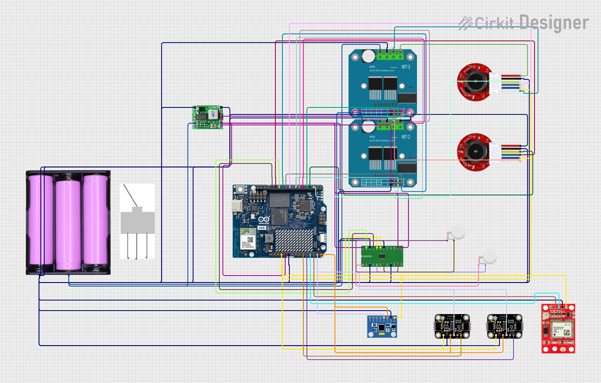
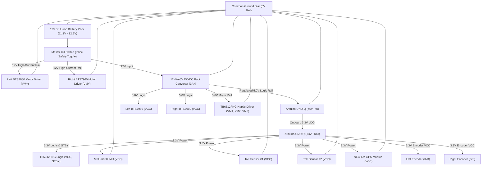

# Circuit Schematic & Pin Connection Guide — Blind Assistant Robot

This document provides the complete schematic diagrams, electrical netlist, pinout tables, and engineering rationale for the **NAVI Blind Assistant Robot** circuit as modeled in Cirkit Designer project [`d6c1d5d1-9d43-4f9d-b31e-ef1cfa1fba4a`](https://app.cirkitdesigner.com/project/d6c1d5d1-9d43-4f9d-b31e-ef1cfa1fba4a).

---

## 🗺️ High-Resolution Circuit Schematic

The complete high-resolution schematic rendered from the Cirkit Designer model ($2681 \times 1708\text{ px}$):

*Raw project file for Cirkit Designer IDE:* [`circuit.ckt`](circuit.ckt)

---

## ⚡ System Power Distribution Architecture

---

## 🔌 Complete Subsystem Pinout & Interconnection Directory

### 1. Power Distribution & Regulation Subsystem

| Source Component & Pin | Destination Component & Pin | Net Type | Voltage | Engineering Rationale ("Why") |
| :--- | :--- | :--- | :--- | :--- |
| **12V Battery [+]** | **Master Kill Switch [Pin 1]** | Raw Battery Line | $12\text{V}$ | Places the physical mechanical disconnect immediately after the battery positive lead to ensure 100% de-energization when switched off. |
| **Master Kill Switch [Pin 2]** | **12V-to-5V Buck [Input +]** | Switched Power | $12\text{V}$ | Feeds unattenuated 12V to the high-efficiency buck converter only when the safety switch is engaged. |
| **Master Kill Switch [Pin 2]** | **Left BTS7960 [VM+]** | High-Current Motor Supply | $12\text{V}$ | Provides direct battery voltage to the Left H-bridge power stage for maximum motor torque without passing through regulators. |
| **Master Kill Switch [Pin 2]** | **Right BTS7960 [VM+]** | High-Current Motor Supply | $12\text{V}$ | Provides direct battery voltage to the Right H-bridge power stage for symmetrical dual-wheel acceleration. |
| **12V Battery [-]** | **Buck Converter [Input -]** | Primary Ground | $0\text{V}$ | Returns battery current to complete the step-down switching loop. |
| **Buck Converter [Output -]** | **Common Ground System** | System Common GND | $0\text{V}$ | Establishes the 0V reference potential across all logic, microcontrollers, and drivers. |
| **Buck Converter [Output +]** | **Arduino UNO Q [+5V]** | Regulated Logic Supply | $5.0\text{V}$ | Delivers stable, high-current 5.0V to power the Qualcomm Linux processor core and STM32 microcontroller. |
| **Buck Converter [Output +]** | **Left BTS7960 [VCC]** | Gate Driver Logic Power | $5.0\text{V}$ | Powers the internal 74HC244 Schmitt-trigger buffer and high-side charge pump gates of the Left H-bridge. |
| **Buck Converter [Output +]** | **Right BTS7960 [VCC]** | Gate Driver Logic Power | $5.0\text{V}$ | Powers the gate driver logic of the Right H-bridge, ensuring full $5\text{V}$ logic gate saturation. |
| **Buck Converter [Output +]** | **TB6612FNG [VM1, VM2, VM3]** | Haptic Motor Power Rail | $5.0\text{V}$ | Supplies 5.0V to drive the coin and cylindrical vibration motors with high tactile force. |

---

### 2. High-Power Drivetrain & Motor Control Subsystem

#### Left Drive Motor Subsystem (BTS7960 & JGA25-371)

| Arduino UNO Q Pin | BTS7960 Left Driver Pin | Signal Type | Signal Function & Engineering Rationale ("Why") |
| :--- | :--- | :--- | :--- |
| **~D5 (PWM)** | **RPWM** | PWM Speed Control | Controls **Forward rotation speed** via hardware Timer PWM (0–255 duty cycle). |
| **~D6 (PWM)** | **LPWM** | PWM Speed Control | Controls **Reverse rotation speed** via hardware Timer PWM (0–255 duty cycle). |
| **D4 (Digital GPIO)** | **REN & LEN** | Bridge Enable | **Dual enable tie**: Setting D4 HIGH enables both half-bridges. Setting D4 LOW instantly puts the motor into free-wheeling coast mode for emergency stops. |
| *Left BTS7960 [MTOR+]* | *Left Motor [motor power +]* | Motor Output A | High-current output supplying modulated 12V to the left armature winding. |
| *Left BTS7960 [MTOR-]* | *Left Motor [motor power -]* | Motor Output B | High-current output completing the left DC motor current path. |

#### Right Drive Motor Subsystem (BTS7960 & JGA25-371)

| Arduino UNO Q Pin | BTS7960 Right Driver Pin | Signal Type | Signal Function & Engineering Rationale ("Why") |
| :--- | :--- | :--- | :--- |
| **~D9 (PWM)** | **RPWM** | PWM Speed Control | Controls **Forward rotation speed** on independent hardware Timer PWM for synchronized tracking. |
| **~D10 (PWM)** | **LPWM** | PWM Speed Control | Controls **Reverse rotation speed** on independent hardware Timer PWM. |
| **D7 (Digital GPIO)** | **REN & LEN** | Bridge Enable | **Dual enable tie**: Enables or disables the right motor H-bridge instantaneously. |
| *Right BTS7960 [MTOR+]* | *Right Motor [motor power +]* | Motor Output A | High-current output supplying modulated 12V to the right armature winding. |
| *Right BTS7960 [MTOR-]* | *Right Motor [motor power -]* | Motor Output B | High-current output completing the right DC motor current path. |

---

### 3. Precision Wheel Odometry Subsystem (Quadrature Encoders)

| Sensor / Motor Encoder Pin | Arduino UNO Q Pin | Interface Type | Technical Function & Engineering Rationale ("Why") |
| :--- | :--- | :--- | :--- |
| **Left Encoder [ENC A]** | **D2** | **External Interrupt 0 (`INT0`)** | **Hardware External Interrupt Pin**: Triggers an instant CPU interrupt Service Routine (`isr_left_encoder`) on every rising edge. Ensures zero missed encoder ticks even at maximum speed (up to $10\text{ kHz}$). |
| **Left Encoder [ENC B]** | **D8** | Digital Input | Reads the secondary quadrature channel to determine instantaneous rotation direction ($+1$ forward, $-1$ reverse) via Phase A/B lead-lag relationship. |
| **Right Encoder [ENC A]** | **D3** | **External Interrupt 1 (`INT1`)** | **Hardware External Interrupt Pin**: Dedicated hardware interrupt for the right wheel encoder, providing microsecond-level tick registration. |
| **Right Encoder [ENC B]** | **D12** | Digital Input | Reads the secondary quadrature channel for the right wheel direction. |
| **Left & Right Encoder [3v3]** | **Arduino [+3V3]** | Sensor Logic Power | Powers the internal optical/Hall sensing elements from the clean, regulated 3.3V rail. |
| **Left & Right Encoder [GND]** | **Common Ground** | Sensor Return | Completes the low-noise encoder signal reference. |

---

### 4. Inertial & Obstacle Sensing Subsystem (I2C Bus)

| Device & Pin | Arduino UNO Q Pin | Protocol / Net | Function & Engineering Rationale ("Why") |
| :--- | :--- | :--- | :--- |
| **MPU-6050 IMU [SDA]** | **A4 (SDA)** | I2C Data Bus | Bidirectional open-drain serial data line transmitting 16-bit Gyro and Accelerometer registers at up to $400\text{ kHz}$. |
| **MPU-6050 IMU [SCL]** | **A5 (SCL)** | I2C Clock Bus | Synchronous clock line generated by the Arduino hardware I2C peripheral. |
| **ToF Sensor #1 [SDA]** | **A4 (SDA)** | I2C Data Bus | Shared I2C data bus for Front-Left laser distance ranging. |
| **ToF Sensor #1 [SCL]** | **A5 (SCL)** | I2C Clock Bus | Shared I2C clock bus for Front-Left laser distance ranging. |
| **ToF Sensor #1 [XSHUT]** | **A0 (Analog/GPIO)** | Hardware Reset | **Address Remapping Control**: Held LOW at boot to keep ToF #1 in hardware shutdown while ToF #2's I2C address is reprogrammed from default `0x29` to `0x31`. Then pulled HIGH and reprogrammed to `0x30`. |
| **ToF Sensor #2 [SDA]** | **A4 (SDA)** | I2C Data Bus | Shared I2C data bus for Front-Right laser distance ranging. |
| **ToF Sensor #2 [SCL]** | **A5 (SCL)** | I2C Clock Bus | Shared I2C clock bus for Front-Right laser distance ranging. |
| **ToF Sensor #2 [XSHUT]** | **A1 (Analog/GPIO)** | Hardware Reset | **Address Remapping Control**: Governs shutdown state of ToF #2 during bus address initialization, completely eliminating I2C address conflict. |

---

### 5. Outdoor Navigation Subsystem (NEO-6M GPS UART)

| NEO-6M GPS Pin | Arduino UNO Q Pin | Signal | Engineering Rationale ("Why") |
| :--- | :--- | :--- | :--- |
| **NEO-6M [TXD]** | **A2** | SoftwareSerial RX | Transmits NMEA sentences ($GGA, $RMC) from GPS module to Arduino. Pin A2 acts as software serial receiver. |
| **NEO-6M [RXD]** | **A3** | SoftwareSerial TX | Transmits configuration commands from Arduino to GPS module. |
| **NEO-6M [VCC]** | **+3V3** | Logic Power | Powers the U-blox 6 RF and baseband circuitry from the low-noise 3.3V rail. |
| **NEO-6M [GND]** | **GND** | System Ground | Common ground reference. |
| *Hardware D0 / D1* | *Reserved for USB* | USB CDC UART | Preserving hardware serial Pins 0 & 1 is critical so the Arduino UNO Q can communicate uninterrupted with the Linux host computer at $115,200\text{ baud}$. |

---

### 6. Dual Haptic Sensory Guidance Subsystem (TB6612FNG Driver)

| Component & Pin | Driver / Arduino Pin | Signal Type | Function & Engineering Rationale ("Why") |
| :--- | :--- | :--- | :--- |
| **TB6612FNG [PWMA]** | **Arduino ~D11 (PWM)** | Intensity PWM | Hardware PWM modulates Channel A motor terminal voltage, allowing smooth variable-amplitude vibration patterns. |
| **TB6612FNG [AIN1]** | **Arduino D13** | Direction / Enable | Digital control line setting polarity of Channel A. |
| **TB6612FNG [AIN2]** | **Common Ground** | Polarity Reference | Tied to Ground so pulsing AIN1 and PWMA produces unidirectional spin without wasting microcontroller pins. |
| **TB6612FNG [AO1]** | **Coin Vibration Motor [+]** | Haptic Power Out + | Modulated 5V output driving the 10mm coin motor. |
| **TB6612FNG [AO2]** | **Coin Vibration Motor [-]** | Haptic Power Out - | Current return through internal low-side MOSFET. |
| **TB6612FNG [BO1]** | **Cylindrical Motor [+]** | Haptic Power Out + | Modulated 5V output driving the high-amplitude ROB-08449 motor. |
| **TB6612FNG [BO2]** | **Cylindrical Motor [-]** | Haptic Power Out - | High-current return through Channel B MOSFET. |
| **TB6612FNG [STBY]** | **Arduino +3V3** | Standby Override | Tied HIGH to 3.3V to permanently keep the driver out of sleep mode, eliminating wake-up delay when an urgent collision alert is triggered. |
| **TB6612FNG [VCC]** | **Arduino +3V3** | Logic Supply | Powers internal CMOS logic gates from clean 3.3V rail. |
| **TB6612FNG [VM1,2,3]** | **Buck Output (+5V)** | Motor Supply Rail | Powers vibration motors from the switching buck converter, isolating electrical motor brush noise from the sensitive 3.3V sensor rail. |

---

## 📜 Full Wire Netlist (66 Wires)

| Wire # | Source Pin | Destination Pin | Subsystem |
| :-: | :--- | :--- | :--- |
| **1** | Battery [-] | TB6612FNG [GND] | Ground Distribution |
| **2** | Battery [-] | TB6612FNG [PGND1] | Power Ground Channel A |
| **3** | Battery [-] | TB6612FNG [PGND2] | Power Ground Channel B |
| **4** | Buck Output [+5V] | TB6612FNG [VM1] | Haptic Motor Power Rail |
| **5** | Battery [-] | NEO-6M GPS [GND] | GPS Signal Return |
| **6** | Battery [+] | Buck Converter [Input +] | 12V Buck Supply |
| **7** | Battery [-] | Buck Converter [Input -] | 12V Buck Return |
| **8** | Buck Output [+5V] | Right BTS7960 [VCC] | Right Driver Logic Supply |
| **9** | Buck Output [+5V] | Left BTS7960 [VCC] | Left Driver Logic Supply |
| **10** | Buck Output [+5V] | Arduino UNO Q [+5V] | Main Controller Logic Supply |
| **11** | Battery [-] | Buck Converter [Output -] | Common Ground Bridge |
| **12** | Battery [-] | Right Motor [GND] | Right Encoder Ground |
| **13** | Battery [-] | ToF Sensor #1 [GND] | Front-Left ToF Ground |
| **14** | Battery [-] | Right BTS7960 [GND] | Right Driver Logic Return |
| **15** | Battery [+] | Right BTS7960 [VM+] | 12V Right Motor Rail |
| **16** | Battery [-] | Right BTS7960 [VM-] | Right Motor Power Ground |
| **17** | Battery [-] | Left BTS7960 [GND] | Left Driver Logic Return |
| **18** | Battery [+] | Left BTS7960 [VM+] | 12V Left Motor Rail |
| **19** | Battery [-] | Left BTS7960 [VM-] | Left Motor Power Ground |
| **20** | Battery [-] | ToF Sensor #2 [GND] | Front-Right ToF Ground |
| **21** | Battery [-] | MPU-6050 IMU [GND] | IMU Return Reference |
| **22** | Battery [-] | Arduino UNO Q [GND] | Main Controller Return |
| **23** | Battery [-] | Left Motor [GND] | Left Encoder Ground |
| **24** | Arduino UNO Q [+3V3] | TB6612FNG [STBY] | Haptic Standby Override |
| **25** | Arduino UNO Q [+3V3] | TB6612FNG [VCC] | Haptic Logic Supply |
| **26** | Buck Output [+5V] | TB6612FNG [VM2] | Haptic Power Channel B |
| **27** | Buck Output [+5V] | TB6612FNG [VM3] | Haptic Power Secondary |
| **28** | Arduino UNO Q [+3V3] | NEO-6M GPS [VCC] | GPS Logic Supply |
| **29** | Arduino UNO Q [+3V3] | Right Motor [3v3] | Right Encoder Hall Supply |
| **30** | Right Motor [ENC A] | Arduino UNO Q [~D3] | **Right Encoder External Interrupt 1** |
| **31** | Right Motor [ENC B] | Arduino UNO Q [D12] | Right Encoder Direction State |
| **32** | Right BTS7960 [MTOR+] | Right Motor [motor power +] | Right Armature Drive A |
| **33** | Right BTS7960 [MTOR-] | Right Motor [motor power -] | Right Armature Drive B |
| **34** | Arduino UNO Q [+3V3] | ToF Sensor #1 [VCC] | Front-Left ToF Supply |
| **35** | Right BTS7960 [LEN] | Arduino UNO Q [D7] | Right Driver Enable Line |
| **36** | Right BTS7960 [LPWM] | Arduino UNO Q [~D10] | Right Motor Reverse PWM |
| **37** | Arduino UNO Q [D7] | Right BTS7960 [REN] | Right Driver Forward Enable |
| **38** | Right BTS7960 [RPWM] | Arduino UNO Q [~D9] | Right Motor Forward PWM |
| **39** | Left BTS7960 [LEN] | Arduino UNO Q [D4] | Left Driver Reverse Enable |
| **40** | Left BTS7960 [LPWM] | Arduino UNO Q [~D6] | Left Motor Reverse PWM |
| **41** | Left BTS7960 [MTOR+] | Left Motor [motor power +] | Left Armature Drive A |
| **42** | Left BTS7960 [MTOR-] | Left Motor [motor power -] | Left Armature Drive B |
| **43** | Arduino UNO Q [D4] | Left BTS7960 [REN] | Left Driver Forward Enable |
| **44** | Left BTS7960 [RPWM] | Arduino UNO Q [~D5] | Left Motor Forward PWM |
| **45** | Arduino UNO Q [+3V3] | ToF Sensor #2 [VCC] | Front-Right ToF Supply |
| **46** | Arduino UNO Q [+3V3] | MPU-6050 IMU [VCC] | IMU Power Supply |
| **47** | Arduino UNO Q [+3V3] | Left Motor [3v3] | Left Encoder Hall Supply |
| **48** | TB6612FNG [AIN1] | Arduino UNO Q [D13] | Coin Motor Direction Bit |
| **49** | Battery [-] | TB6612FNG [AIN2] | Coin Motor Fixed Ground Reference |
| **50** | TB6612FNG [AO1] | Coin Motor [+] | Coin Motor Positive Drive |
| **51** | TB6612FNG [AO2] | Coin Motor [-] | Coin Motor Negative Return |
| **52** | TB6612FNG [PWMA] | Arduino UNO Q [~D11] | Coin Motor Haptic Intensity PWM |
| **53** | NEO-6M GPS [RXD] | Arduino UNO Q [A3] | GPS Command Transmit |
| **54** | NEO-6M GPS [TXD] | Arduino UNO Q [A2] | GPS Data Receive |
| **55** | Arduino UNO Q [A5] | ToF Sensor #1 [SCL] | Shared I2C Clock Bus |
| **56** | Arduino UNO Q [A4] | ToF Sensor #1 [SDA] | Shared I2C Data Bus |
| **57** | Arduino UNO Q [A0] | ToF Sensor #1 [XSHUT] | ToF #1 Dynamic Address Reset |
| **58** | Arduino UNO Q [A5] | ToF Sensor #2 [SCL] | Shared I2C Clock Bus |
| **59** | Arduino UNO Q [A4] | ToF Sensor #2 [SDA] | Shared I2C Data Bus |
| **60** | Arduino UNO Q [A1] | ToF Sensor #2 [XSHUT] | ToF #2 Dynamic Address Reset |
| **61** | Arduino UNO Q [A5] | MPU-6050 IMU [SCL] | Shared I2C Clock Bus |
| **62** | Arduino UNO Q [A4] | MPU-6050 IMU [SDA] | Shared I2C Data Bus |
| **63** | Left Motor [ENC A] | Arduino UNO Q [D2] | **Left Encoder External Interrupt 0** |
| **64** | Left Motor [ENC B] | Arduino UNO Q [D8] | Left Encoder Direction State |
| **65** | TB6612FNG [BO2] | Cylindrical Motor [-] | High-Amplitude Motor Return |
| **66** | TB6612FNG [BO1] | Cylindrical Motor [+] | High-Amplitude Motor Drive |
