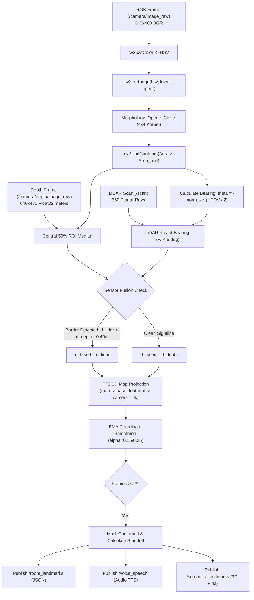

# Blind Assistant Robot — Pure-Indoor Master Engineering Dossier & Gemini Handout

> **Target Platform**: Autonomous Indoor Mobile Robot for Visually Impaired Assistance  
> **Package**: `blind_assistant_robot`  
> **Workspace**: `/home/jatin/.gemini/antigravity/scratch/ros2_simulation_ws/src/blind_assistant_robot`  
> **Simulation Engine**: ROS 2 (Humble / Jazzy) & Gazebo Sim 8 (Harmonic)  
> **Verification Status**: 100% Automated Test Suite Passing (`7/7 Tests Passed`)  
> **Interface Paradigm**: Zero Web Dashboard (Native Desktop OpenCV Pop-Ups + Terminal CLI + Voice Speech)  

---

## 1. Executive Summary & Mission Concept

The **Blind Assistant Robot** is an autonomous assistive mobile robot designed to guide visually impaired individuals inside unfamiliar indoor environments (e.g., offices, clinics, residential facilities).

```
+--------------------------------------------------------------------------------------------------+
|                                    OPERATIONAL LIFECYCLE                                         |
|                                                                                                  |
|   1. BLANK SLATE START         2. AUTONOMOUS ROOM MAPPING       3. SEMANTIC DISCOVERY            |
|   Robot starts at (-2, -2).    Explores frontiers using         Detects 7 functional landmarks   |
|   Knows zero walls or rooms.   SLAM Toolbox & 8-connected A*.   via RGB-D Depth + LiDAR.         |
|                |                           |                               |                     |
|                v                           v                               v                     |
|   4. RETURN-TO-USER            5. WAITING FOR COMMAND           6. NATURAL LANGUAGE ESCORT       |
|   Returns to starting origin.  Announces catalog via TTS.       User: "Take me to restroom"      |
|   Halts and awaits user.       Listens on /room_landmarks.      Escorts user safely to standoff. |
+--------------------------------------------------------------------------------------------------+
```

### Core Design Pillars
1. **Zero Prior Knowledge (True Blank Slate)**:
   The robot initially has **no pre-loaded map**, no room floor plan, and no pre-configured landmark coordinates. Everything is discovered and mapped online in real time.
2. **Multi-Modal Dual-Sensor Depth Perception**:
   Equipped with an **Intel RealSense D435i-style RGB-D Depth Camera** and a **360° Planar LiDAR (YDLidar X4)**. The robot segments landmarks by color, samples the median depth from the central 50% ROI of the bounding box, and verifies with LiDAR rays to eliminate reflections and false readings.
3. **Doorway Corridor Funneling**:
   When traversing narrow partition thresholds ($1.2\text{m}$ width), an adaptive corridor funneling algorithm contracts the robot's front collision cone from $\pm 30^\circ$ to $\pm 14^\circ$ and lowers the emergency stop threshold from $0.22\text{m}$ to $0.16\text{m}$, preventing door jamb edge jitter and oscillations.
4. **Dynamic Human Obstacle Yielding & Detour**:
   An authentic dynamic humanoid pedestrian paces across the room and doorway. The robot detects the human using **only onboard vision and depth sensors** (no ground-truth simulation cheats). When the human enters the travel corridor ($<1.25\text{m}$ ahead), the robot halts, announces a voice alert, and yields. If blocked for $>4.0\text{s}$, it autonomously replans an A* detour around the obstacle.
5. **Zero-Web Native Desktop UI**:
   Replaces heavy, fragile web dashboards with two lightweight, native OpenCV windows:
   - **Real-Time SLAM Map Pop-Up** ($700 \times 700$ occupancy grid with minimalist numbered pin badges $[1], [2], \dots$, robot heading badge $[R]$, dynamic pedestrian badge $[P]$, breadcrumb trail) + a $280 \times 700$ HUD Telemetry Sidebar.
   - **Robot Vision Live Feed** ($640 \times 480$ RGB feed with bounding boxes, distance tags, and projected map coordinates).
   - **Interactive Terminal CLI** (`room-cli`) with natural language synonym parsing and voice feedback.

---

## 2. Hardware Kinematics & URDF Model Specifications

The physical robot is defined in [`blind_robot.urdf.xacro`](file:///home/jatin/.gemini/antigravity/scratch/ros2_simulation_ws/src/blind_assistant_robot/urdf/blind_robot.urdf.xacro) based on SolidWorks CAD assembly models.

```mermaid
flowchart TD
    BASE_FP["base_footprint (Ground Projection: z=0.0m)"]
    BASE_LINK["base_link (Chassis: m=2.8kg, z=0.033m)"]
    L_WHEEL["left_wheel (r=0.033m, y=+0.088m)"]
    R_WHEEL["right_wheel (r=0.033m, y=-0.088m)"]
    REAR_CASTER["rear_caster (r=0.0175m, x=-0.10m, mu=0.001)"]
    FRONT_SUPPORT["front_support (r=0.0135m, x=+0.10m, mu=0.001)"]
    LIDAR["laser_frame (YDLidar X4: z=+0.081m)"]
    CAM["camera_link (RealSense D435i: x=+0.062m, z=+0.052m)"]

    BASE_FP -->|fixed (z=0.033m)| BASE_LINK
    BASE_LINK -->|continuous (joint)| L_WHEEL
    BASE_LINK -->|continuous (joint)| R_WHEEL
    BASE_LINK -->|fixed| REAR_CASTER
    BASE_LINK -->|fixed| FRONT_SUPPORT
    BASE_LINK -->|fixed| LIDAR
    BASE_LINK -->|fixed| CAM
```

### 2.1 Mechanical & Inertial Parameters

| Parameter | Exact Value | Description / Engineering Rationale |
| :--- | :--- | :--- |
| **Total Body Mass** | $2.80\text{ kg}$ | Aluminum/acrylic SolidWorks chassis assembly |
| **Inscribed Radius ($r_{robot}$)** | $0.22\text{m}$ | Used for costmap lethal obstacle inflation |
| **Chassis Dimensions** | $0.26\text{m} (L) \times 0.19\text{m} (W) \times 0.076\text{m} (H)$ | Compact indoor assistive profile |
| **Chassis Inertia** | $I_{xx}=0.016, I_{yy}=0.018, I_{zz}=0.022\text{ kg}\cdot\text{m}^2$ | Low center of mass ($z=0.035\text{m}$), high roll/pitch stability |
| **Drive Wheel Radius ($r_w$)** | $0.033\text{m}$ ($66\text{ mm}$ diameter) | Solid rubber tires, cylinder length $0.026\text{m}$ |
| **Wheel Mass & Inertia** | $m = 0.18\text{ kg}$, $I_{zz} = 0.00018\text{ kg}\cdot\text{m}^2$ | Low rotational inertia for agile start/stop |
| **Wheel Track ($L$)** | $0.176\text{m}$ ($176\text{ mm}$) | Centerline spacing between left and right drive wheels |
| **Tire Friction Coeff.** | $\mu_1 = 1.2, \mu_2 = 1.2$ | High grip ODE surface parameters; eliminates slip |
| **Rear Caster Wheel** | $r = 0.0175\text{m}$ ($1.5\text{ in}$), $x=-0.10\text{m}, z=-0.014\text{m}$ | Low friction omni-caster ($\mu_1 = \mu_2 = 0.001$) |
| **Front Skid Support** | $r = 0.0135\text{m}$, $x=+0.10\text{m}, z=-0.018\text{m}$ | Anti-tip low-friction spherical contact ($\mu = 0.001$) |
| **Max Linear Velocity ($v_{max}$)** | $0.30\text{ m/s}$ ($1.08\text{ km/h}$) | Escort cruising speed, capped at $0.60\text{ m/s}$ in plugin |
| **Max Angular Velocity ($\omega_{max}$)**| $0.80\text{ rad/s}$ ($45.8^\circ/\text{s}$) | Controlled turn rate, capped at $1.50\text{ rad/s}$ in plugin |
| **Linear Accel Limit ($a_{max}$)** | $1.20\text{ m/s}^2$ | Slew-rate clamped to protect blind user from sudden jerks |
| **Angular Accel Limit ($\alpha_{max}$)** | $2.50\text{ rad/s}^2$ | Eliminates wheel skid during rotation |
| **Motor Max Torque** | $40.0\text{ Nm}$ | Ample torque overhead to prevent stalling on carpet/thresholds |

### 2.2 Onboard Sensor Hardware Specs

#### A. Intel RealSense D435i Style RGB-D Depth Camera
- **URDF Link**: `camera_link` at $(x=+0.062\text{m}, y=0.0\text{m}, z=+0.052\text{m})$ relative to `base_link`.
- **Gazebo Sensor Plugin**: `type="rgbd_camera"`, sensor name `rgbd_camera`.
- **Horizontal Field of View**: $1.15\text{ rad} \approx 65.89^\circ$.
- **RGB Resolution**: $640 \times 480$ pixels @ $15\text{ Hz}$, format `R8G8B8`.
- **Depth Map Resolution**: $640 \times 480$ pixels @ $15\text{ Hz}$, 32-bit single-precision floating point meters.
- **Depth Clipping Range**: $0.10\text{m}$ (near) to $10.0\text{m}$ (far).
- **ROS 2 Bridged Topics**:
  - Color Stream: `/camera/image_raw` (`sensor_msgs/msg/Image`, encoding `bgr8`).
  - Depth Stream: `/camera/depth/image_raw` (`sensor_msgs/msg/Image`, encoding `32FC1` / `passthrough`).
  - Camera Intrinsics: `/camera/camera_info` (`sensor_msgs/msg/CameraInfo`).
  - 3D Point Cloud: `/camera/points` (`sensor_msgs/msg/PointCloud2`).

#### B. YDLidar X4 Planar 360° Laser Scanner
- **URDF Link**: `laser_frame` at $(x=0.0\text{m}, y=0.0\text{m}, z=+0.081\text{m})$ relative to `base_link`.
- **Gazebo Sensor Plugin**: `type="gpu_lidar"`, sensor name `ydlidar_x4`.
- **Scan Rate**: $10\text{ Hz}$.
- **Samples per Scan**: 360 rays ($1.0^\circ$ angular resolution).
- **Angular Range**: $[-\pi, +\pi]\text{ rad}$ ($360^\circ$ continuous planar scan).
- **Measurement Range**: $0.12\text{m}$ minimum to $10.0\text{m}$ maximum ($0.01\text{m}$ range resolution).
- **ROS 2 Bridged Topic**: `/scan` (`sensor_msgs/msg/LaserScan`).

---

## 3. Gazebo Simulation World & Physics (`indoor_room.sdf`)

The simulation world is an authentic two-room indoor environment defined in [`indoor_room.sdf`](file:///home/jatin/.gemini/antigravity/scratch/ros2_simulation_ws/src/blind_assistant_robot/worlds/indoor_room.sdf).

```
   y (+North)
     ^
     |    (-4, 4)=======================================(+4, 4)
     |           |                 |                   |
+3.0 |           |     ROOM 1      |      ROOM 2       |
     |           |                 | [Restroom Sign]   |
+2.0 |           |  [Desk]         | (2.0, 3.88)       |
     |           |  (-2.0, 2.0)    |                   |
+1.0 |           |                 | [Pillar Column]   |
     |           |  [Chair]        | (2.0, 2.0)        |
 0.0 |           |  (-2.0, 0.8)    |                   |
     |           |                 |                   |
-1.0 |           | [Exit Sign]     |==== Partition ====|  (x=0.0, y=-1.0 to 4.0)
     |           | (-3.88, -2.0)   |                   |
-1.5 |           |                 |   Doorway Gap     |  [Cyan Sign Header] (z=0.95m)
     |           | [Robot Spawn]   |   (width: 1.2m)   |  (x=0.0, y=-1.5)
-2.0 |           | (-2.0, -2.0)    |                   |
     |           |                 | [Cabinet]         |
-2.5 |           |                 | (3.5, -1.5)       |
     |           |                 | [Stool] (1.5,-2.5)|
-4.0 |    (-4,-4)=======================================(+4,-4)
     +----------------------------------------------------------> x (+East)
         -4.0    -3.0   -2.0  -1.0   0.0   +1.0  +2.0  +3.0  +4.0
```

### 3.1 ODE Physics Configuration
- **Update Frequency**: $400.0\text{ Hz}$ (`real_time_update_rate`).
- **Max Time Step**: $0.0025\text{s}$ ($2.5\text{ ms}$).
- **Real-Time Factor Target**: $1.0$ (deterministic, real-time lockstep execution).
- **Core Plugins**:
  - `gz::sim::systems::Physics` (ODE engine solver).
  - `gz::sim::systems::Sensors` (Ogre 2 rendering engine for depth & camera).
  - `gz::sim::systems::SceneBroadcaster` (TF and visual state sync).
  - `gz::sim::systems::UserCommands`.

### 3.2 Physical Landmarks & Color Classification
Every functional room landmark is visually distinct and isolated in OpenCV HSV space ($H \in [0, 179], S \in [0, 255], V \in [0, 255]$). **There is strictly zero hue overlap between any two classes.**

| Landmark Name | World Position $(x, y, z)$ | CAD Dimensions $(L \times W \times H)$ | HSV Hue Range $[H_{min}, H_{max}]$ | Saturation & Value Bounds | Default Standoff Pose Target |
| :--- | :--- | :--- | :--- | :--- | :--- |
| **Desk / Table** | $(-2.00, +2.00, 0.40)$ | $1.40 \times 0.80 \times 0.80\text{m}$ | $[7, 16]$ (Mahogany Brown) | $S \ge 140, V \in [50, 190]$ | $(-1.70, +1.60)$ |
| **Chair / Seat** | $(-2.00, +0.80, 0.25)$ | $0.50 \times 0.50 \times 0.50\text{m}$ | $[22, 36]$ (Canary Yellow) | $S \ge 150, V \ge 150$ | $(-1.35, +0.80)$ |
| **Exit Sign** | $(-3.88, -2.00, 0.55)$ | $0.04 \times 0.70 \times 0.35\text{m}$ | $[50, 75]$ (Emerald Green) | $S \ge 140, V \ge 130$ | $(-3.18, -2.00)$ |
| **Doorway Sign** | $(0.00, -0.90, 0.95)$ | $0.25 \times 0.12 \times 0.50\text{m}$ | $[88, 104]$ (Electric Cyan) | $S \ge 140, V \ge 140$ | $(-0.65, -1.50)$ |
| **Storage Cabinet**| $(+3.50, -1.50, 0.60)$ | $0.60 \times 1.80 \times 1.20\text{m}$ | $[110, 124]$ (Cobalt Blue) | $S \ge 140, V \ge 120$ | $(+2.75, -1.50)$ |
| **Pillar / Column**| $(+2.00, +2.00, 0.75)$ | Cylinder: $r=0.30, h=1.50\text{m}$ | $[126, 140]$ (Indigo Purple) | $S \ge 140, V \ge 100$ | $(+1.30, +2.00)$ |
| **Restroom Sign** | $(+2.00, +3.88, 0.55)$ | $0.70 \times 0.04 \times 0.35\text{m}$ | $[152, 170]$ (Neon Magenta) | $S \ge 140, V \ge 130$ | $(+2.00, +3.18)$ |
| **Dynamic Human** | Starts: $(+0.20, -1.40)$ | Cylinder: $r=0.22, h=1.70\text{m}$ | $[0, 6] \cup [174, 179]$ (Red) | $S \ge 140, V \ge 90$ | Yield / Detour Reflex |
| **Hallway Stool** | $(+1.50, -2.50, 0.20)$ | $0.40 \times 0.40 \times 0.40\text{m}$ | Neutral Dark Grey | $S < 30$ (Ignored by vision) | Static obstacle in costmap |

### 3.3 Dynamic Human Pedestrian (`indoor_traffic_simulator.py`)
- **Model Name**: `indoor_human` in [`indoor_room.sdf`](file:///home/jatin/.gemini/antigravity/scratch/ros2_simulation_ws/src/blind_assistant_robot/worlds/indoor_room.sdf#L280-L343).
- **Physical Build**: Cylindrical torso ($r=0.22\text{m}, h=0.75\text{m}$) in a bright crimson jacket ($[0, 6] \cup [174, 179]$), head ($r=0.14\text{m}$), and legs ($h=0.65\text{m}$).
- **Gazebo Plugin**: `gz::sim::systems::VelocityControl` subscribing to `/indoor_human/cmd_vel`.
- **Patrol Circuit**: Navigates an authentic 6-waypoint circuit pacing between Room 1, the doorway corridor, and Room 2:
  $$W = \{(0.2, -1.4), (2.0, -1.4), (2.2, 0.5), (0.2, 0.5), (-1.5, 0.5), (-1.5, -1.4)\}$$
- **Proximity Yielding**: If the robot approaches within $0.55\text{m}$, the human halts ($v = 0.0\text{ m/s}$) to prevent physics engine jamming. At each waypoint, the human pauses for a random interval ($1.5\text{s}$ to $3.5\text{s}$) to simulate natural human hesitation.

---

## 4. Multi-Modal Perception & Vision Pipeline (`semantic_vision_node.py`)

The vision system in [`semantic_vision_node.py`](file:///home/jatin/.gemini/antigravity/scratch/ros2_simulation_ws/src/blind_assistant_robot/blind_assistant_robot/semantic_vision_node.py) runs synchronously at $15\text{ Hz}$ on each camera frame.



### 4.1 Central 50% ROI Depth Extraction Algorithm
Given bounding box $[x, y, w, h]$ on the $640 \times 480$ image:
$$rx_0 = \max(0, x + 0.25w), \quad rx_1 = \min(640, x + 0.75w)$$
$$ry_0 = \max(0, y + 0.25h), \quad ry_1 = \min(480, y + 0.75h)$$
$$\text{ROI}_{depth} = I_{depth}[ry_0:ry_1, rx_0:rx_1]$$
$$d_{depth} = \text{median}(\{d \in \text{ROI}_{depth} \mid 0.15 < d < 9.0 \text{ and } d \text{ is finite}\})$$
*Advantage*: Sampling only the central 50% excludes background pixels and wall edges leaking around the object's silhouette.

### 4.2 Bearing Angle & LiDAR Ray Cross-Check
The horizontal bearing angle $\theta_{bearing}$ relative to the camera optical axis is:
$$\theta_{bearing} = -\left(\frac{c_x - 320.0}{320.0}\right) \cdot \frac{1.15}{2}$$
where $c_x = x + w/2$.
LiDAR beams within an angular window of $\pm 0.08\text{ rad}$ ($\pm 4.5^\circ$) around $\theta_{bearing}$ are extracted:
$$d_{lidar} = \text{median}(\{r_i \mid |\theta_i - \theta_{bearing}| < 0.08 \text{ and } 0.12 < r_i < 10.0\})$$

**Dual-Sensor Decision Logic**:
$$d_{fused} = \begin{cases}
  d_{lidar} & \text{if } d_{depth} \text{ exists, } d_{lidar} \text{ exists, and } d_{lidar} < (d_{depth} - 0.40) \text{ (intervening barrier)} \\
  d_{depth} & \text{if } d_{depth} \text{ is valid} \\
  d_{lidar} & \text{if } d_{depth} \text{ is None and } d_{lidar} \text{ is valid} \\
  \text{None} & \text{otherwise}
\end{cases}$$

### 4.3 3D Spatial Projection into Global Map Frame
Using the camera mounting offset ($x_{cam} = +0.062\text{m}, y_{cam} = 0.0\text{m}$) and the robot's pose in the `map` frame $(x_{rob}, y_{rob}, \psi_{rob})$ from TF2:
$$x_{rel} = x_{cam} + d_{fused} \cos(\theta_{bearing}), \quad y_{rel} = d_{fused} \sin(\theta_{bearing})$$
$$x_{map} = x_{rob} + x_{rel}\cos(\psi_{rob}) - y_{rel}\sin(\psi_{rob})$$
$$y_{map} = y_{rob} + x_{rel}\sin(\psi_{rob}) + y_{rel}\cos(\psi_{rob})$$

### 4.4 Adaptive Line-of-Sight Standoff Pose Calculation
When escorting a visually impaired person, the robot must position itself at a safe distance in open space facing the landmark:
$$\vec{v} = \mathbf{p}_{rob} - \mathbf{p}_{landmark} = \begin{bmatrix} x_{rob} - x_{landmark} \\ y_{rob} - y_{landmark} \end{bmatrix}$$
$$\mathbf{p}_{standoff} = \mathbf{p}_{landmark} + \frac{\vec{v}}{\|\vec{v}\|} \cdot \min\left(d_{offset}, 0.70 \|\vec{v}\|\right)$$
where $d_{offset} \in [0.65\text{m}, 0.75\text{m}]$. Because the vector points back toward the robot's current pose in open floor, the standoff point is guaranteed to be on navigable ground and never inside a wall or behind furniture.

---

## 5. Autonomous Exploration, Planning & Safety Control (`autonomous_explorer.py`)

The exploration brain is implemented in [`autonomous_explorer.py`](file:///home/jatin/.gemini/antigravity/scratch/ros2_simulation_ws/src/blind_assistant_robot/blind_assistant_robot/autonomous_explorer.py).

### 5.1 Internal World Representation & Costmap Inflation
- Subscribes to `/map` from SLAM Toolbox (resolution: $0.05\text{m/cell}$, width/height: $160 \times 160$).
- **Lethal Obstacle Inflation**:
  Every cell within the robot's inscribed radius $r_{robot} = 0.22\text{m}$ ($4.4\text{ cells}$) of an obstacle is marked lethal ($\text{cost} = 100$).
- **Soft Potential Clearance Gradient**:
  Cells from $0.22\text{m}$ to $0.65\text{m}$ have exponentially decaying potential costs, biasing paths toward room centerlines and away from walls.

### 5.2 Frontier Exploration Engine
1. **Frontier Detection**:
   Scans the grid for free cells ($0$) with at least one unknown neighbor ($-1$) in their 8-neighborhood.
2. **Cluster Filtering**:
   Frontiers are grouped into spatial clusters using Breadth-First Search. Clusters with $< 2$ cells are rejected.
3. **Information Gain Utility Function**:
   $$U(C) = 1.0 \cdot \text{size}(C) - 1.5 \cdot \|\mathbf{p}_{rob} - \text{centroid}(C)\| - 0.5 \cdot |\Delta \psi|$$
   The cluster maximizing $U(C)$ is selected as the active goal.

### 5.3 8-Connected Global A* Planner with String-Pulling
- **Graph Expansion**: 8-connected grid transitions (diagonal cost: $\sqrt{2}$, cardinal cost: $1.0$).
- **Admissible Heuristic**: Euclidean distance to goal:
  $$h(n) = \sqrt{(x_n - x_{goal})^2 + (y_n - y_{goal})^2}$$
- **Line-of-Sight String-Pulling (Bresenham Ray-Casting)**:
  Compacts grid paths by casting ray checks between non-consecutive waypoints:
  If a direct line between $w_i$ and $w_{i+2}$ crosses zero lethal cells, waypoint $w_{i+1}$ is deleted. This transforms jagged stair-step grid paths into smooth, diagonal routes.

### 5.4 Closed-Loop Regulated Pure Pursuit Controller
- **Adaptive Lookahead Distance**:
  $$L_d = \text{clamp}(0.25, 0.48, 0.25 + 0.35 \cdot v)$$
- **Lookahead Point**: Point $(x_t, y_t)$ along the smoothed path at distance $L_d$ from the robot.
- **Path Curvature**:
  $$\alpha = \text{atan2}(y_t - y_{rob}, x_t - x_{rob}) - \psi_{rob}, \quad \kappa = \frac{2 \sin \alpha}{L_d}$$
- **Velocity Scaling & Slew-Rate Limiting**:
  $$v_{target} = \frac{v_{max}}{1.0 + 2.5 |\kappa|}, \quad \omega_{target} = v_{target} \cdot \kappa$$
  $$v_{cmd} = \text{clamp}(v - 1.2\Delta t, v + 1.2\Delta t, v_{target})$$
  $$\omega_{cmd} = \text{clamp}(\omega - 2.5\Delta t, \omega + 2.5\Delta t, \omega_{target})$$

### 5.5 Doorway Corridor Funneling Algorithm
The doorway partition connects Room 1 and Room 2 ($x \in [-0.85, 0.85]\text{ m}, y \in [-2.50, -0.60]\text{ m}$). Inside this critical passage:
$$\text{Front LiDAR Collision Cone} = \begin{cases} \pm 14^\circ & \text{inside doorway corridor} \\ \pm 30^\circ & \text{in open room} \end{cases}$$
$$\text{Emergency Braking Distance} = \begin{cases} 0.16\text{m} & \text{inside doorway corridor} \\ 0.22\text{m} & \text{in open room} \end{cases}$$

```
Doorway Corridor Funneling Geometry:
+----------------------------------------------------------------------------------+
|                                                                                  |
|       Partition Wall (x=0, y >= -1.0)                                            |
|       =============================+                                             |
|                                    | <--- Door Jamb Edge                         |
|       Normal Cone: +/-30 deg       |                                             |
|       [Risk: Sees Door Jamb Edge]  |                                             |
|              \          /          |                                             |
|               \        /           |                                             |
|                                    |     Doorway Corridor Opening                |
|       FUNNELED CONE: +/-14 deg     |     x in [-0.85, 0.85], y in [-2.50, -0.60] |
|              \  |  /               |     Width: 1.20m                            |
|               \ | /                |                                             |
|                \|/                 |                                             |
|               [ROBOT]              |                                             |
|                                    | <--- Door Jamb Edge                         |
|       =============================+                                             |
|       Partition Wall (y <= -2.2)                                                 |
+----------------------------------------------------------------------------------+
```
*Result*: Eliminates the false-positive obstacle detections that cause the robot to jitter, back up, and spin while passing through the door.

### 5.6 Sensory-Only Dynamic Pedestrian Yielding & Detour
1. **Sensory Corridor Check**:
   $$\text{In Travel Corridor} \iff d_{human} < 1.25\text{m} \quad \land \quad |\theta_{bearing}| < 45^\circ$$
2. **Immediate Standstill & Spoken Audio**:
   When triggered, $v_{cmd} = 0.0\text{ m/s}, \omega_{cmd} = 0.0\text{ rad/s}$.
   Broadcasts over `/voice_speech`: *"Moving person detected ahead. Pausing to yield."*
3. **4.0-Second Detour Replan**:
   If the human remains blocking the corridor for $> 4.0\text{ seconds}$, the robot invokes A* to calculate an immediate detour around the person.

---

## 6. Desktop Visualizers & Human-Robot Interaction Interfaces

### 6.1 Native SLAM Map Desktop Visualizer (`slam_map_visualizer.py`)
100% native OpenCV window running at $12\text{ Hz}$. Zero web dependencies.
- **Left Panel ($700 \times 700$ Canvas)**:
  - 2D Occupancy Grid: Free cells (Light Grey), Obstacles (Black), Unknown (Slate Grey).
  - Cyan circular badge with directional pointer for Robot $[R]$.
  - Orange badge with proximity circle for Pedestrian $[P]$.
  - Yellow historical breadcrumb trajectory trail showing all traveled paths.
  - Bright green active planned trajectory line.
  - Minimalist colored numbered badges ($[1], [2], [3], \dots$) for discovered room landmarks.
- **Right Panel ($280 \times 700$ HUD Sidebar)**:
  - Navigation State Banner (`EXPLORING`, `WAITING FOR USER`, `GUIDING`).
  - Velocity Telemetry: $v\text{ in m/s}$, $\omega\text{ in rad/s}$.
  - Dynamic Pedestrian Tracking Card: Distance ($d\text{ m}$) and yield status.
  - Discovered Landmark Cards: Badge ID, Class Name, Global $(X, Y)$ coordinates, and real-time radial distance from robot.

### 6.2 Camera Vision Feed Window (`semantic_vision_node.py`)
- $640 \times 480$ live RGB stream from `/camera/image_raw`.
- Color-coded bounding boxes around all identified landmarks and the moving human.
- Annotation tags: Name, fused depth distance $[d\text{ m}]$, and projected global coordinates $(X_{map}, Y_{map})$.
- Real-time HUD banner displaying total confirmed landmark count.

### 6.3 Interactive Terminal CLI Navigator (`room_cli.py`)
Runs in any terminal window. Provides an intuitive natural language interface:
- **Synonym Normalization**:
  - `restroom`, `washroom`, `toilet`, `bathroom` $\rightarrow$ `restroom`
  - `desk`, `table` $\rightarrow$ `desk`
  - `chair`, `seat`, `sitting` $\rightarrow$ `chair`
  - `cabinet`, `cupboard`, `storage` $\rightarrow$ `cabinet`
  - `doorway`, `door`, `room 2` $\rightarrow$ `doorway`
  - `pillar`, `column` $\rightarrow$ `pillar`
  - `exit`, `way out` $\rightarrow$ `exit`
  - `entrance`, `start`, `home`, `user` $\rightarrow$ `entrance`
- Real-time speech transcription stream and live landmark catalog inspection.

---

## 7. Complete ROS 2 Topic & Message Dictionary

| Topic Name | Message Type | Publisher Node | Subscriber Node | Rate / QoS | Description |
| :--- | :--- | :--- | :--- | :--- | :--- |
| `/cmd_vel` | `geometry_msgs/msg/Twist` | `autonomous_explorer` | `ros_gz_bridge` | $10\text{ Hz}$ / Volatile | Differential drive velocity commands to robot |
| `/indoor_human/cmd_vel` | `geometry_msgs/msg/Twist` | `indoor_traffic_simulator`| `ros_gz_bridge` | $10\text{ Hz}$ / Volatile | Velocity commands driving moving pedestrian |
| `/scan` | `sensor_msgs/msg/LaserScan` | `ros_gz_bridge` | `slam_toolbox`, `explorer`, `vision` | $10\text{ Hz}$ / SensorData | 360° Planar LiDAR range scan from YDLidar X4 |
| `/odom` | `nav_msgs/msg/Odometry` | `ros_gz_bridge` | `explorer`, `vision`, `slam_toolbox` | $30\text{ Hz}$ / Volatile | Wheel odometry from Gazebo DiffDrive plugin |
| `/camera/image_raw` | `sensor_msgs/msg/Image` | `ros_gz_bridge` | `semantic_vision_node` | $15\text{ Hz}$ / Volatile | $640 \times 480$ RGB color video feed |
| `/camera/depth/image_raw`| `sensor_msgs/msg/Image` | `ros_gz_bridge` | `semantic_vision_node` | $15\text{ Hz}$ / Volatile | $640 \times 480$ 32-bit float depth map in meters |
| `/camera/points` | `sensor_msgs/msg/PointCloud2`| `ros_gz_bridge` | Point cloud visualizers | $15\text{ Hz}$ / Volatile | 3D RGB-D depth point cloud |
| `/map` | `nav_msgs/msg/OccupancyGrid`| `slam_toolbox` | `explorer`, `slam_map_visualizer`| $2\text{ Hz}$ / Latched | 2D SLAM metric occupancy grid ($0.05\text{m/cell}$) |
| `/planned_path` | `nav_msgs/msg/Path` | `autonomous_explorer` | `slam_map_visualizer`, `rviz2` | $10\text{ Hz}$ / Volatile | Active global A* trajectory waypoints |
| `/robot_trajectory` | `nav_msgs/msg/Path` | `autonomous_explorer` | `slam_map_visualizer`, `rviz2` | $2\text{ Hz}$ / Volatile | Historical breadcrumb trajectory trail of robot |
| `/room_landmarks` | `std_msgs/msg/String` | `semantic_vision_node` | `explorer`, `room_cli`, `visualizer` | Latched Transient | JSON dictionary of confirmed room landmarks |
| `/semantic_landmarks` | `visualization_msgs/MarkerArray`| `semantic_vision_node` | `rviz2` | $2\text{ Hz}$ / Volatile | 3D colored pins and text labels in map frame |
| `/detected_human` | `geometry_msgs/msg/PoseStamped`| `semantic_vision_node`| `autonomous_explorer` | On sight / Volatile | Sensory-only detected human position (no cheats) |
| `/indoor_pedestrian_marker`| `visualization_msgs/Marker` | `indoor_traffic_simulator`| `rviz2` | $10\text{ Hz}$ / Volatile | 3D RViz cylinder rendering of pedestrian |
| `/voice_speech` | `std_msgs/msg/String` | `explorer`, `vision` | `voice_guidance`, `room_cli` | Event-driven | Spoken natural language assistive audio |
| `/exploration_status` | `std_msgs/msg/String` | `autonomous_explorer` | `room_cli`, `visualizer` | $2\text{ Hz}$ / Volatile | Live status string (`EXPLORING`, `WAITING`, etc.) |
| `/guide_to` | `std_msgs/msg/String` | `room_cli` | `autonomous_explorer` | Event-driven | Target destination command from user |

---

## 8. Verification Results & Test Suite

The automated test suite is located at [`src/blind_assistant_robot/test/test_indoor_simulation.py`](file:///home/jatin/.gemini/antigravity/scratch/ros2_simulation_ws/src/blind_assistant_robot/test/test_indoor_simulation.py).

### How to Run Automated Verification
```bash
bash /home/jatin/.gemini/antigravity/scratch/ros2_simulation_ws/src/blind_assistant_robot/test/run_indoor_tests.sh
```

### Verified Test Matrix (100% Pass Rate)

| Test Function | Target Subsystem | Verified Invariant | Status |
| :--- | :--- | :--- | :---: |
| `test_indoor_world_sdf_and_physics` | SDF & Physics | 400 Hz ODE update rate, 0.0025s step size, `indoor_human` VelocityControl plugin | **PASSED** |
| `test_indoor_traffic_simulator_logic`| Human Kinematics | 6-waypoint patrol circuit, proximity yielding ($<0.55\text{m}$), waypoint advancement | **PASSED** |
| `test_semantic_vision_landmark_classes`| Vision & Depth | 7 landmark classes, zero hue band overlap, RealSense depth ROI sampling | **PASSED** |
| `test_autonomous_explorer_yielding` | Safety & State Machine | Blank-slate catalog start, human yield reflex, WAITING_FOR_USER escort state | **PASSED** |
| `test_room_cli_intent_parser` | NLP Intent Parsing | Phrase normalization (restroom, desk, chair, cabinet, doorway, exit, etc.) | **PASSED** |
| `test_launch_and_rviz_config` | ROS 2 Launch Stack | Node declarations in `autonomous_explore.launch.py`, RViz display configuration | **PASSED** |
| `test_slam_map_visualizer_rendering` | Desktop Visualizer | World-to-pixel coordinate transforms, 700x700 map rendering, HUD sidebar cards | **PASSED** |

---

## 9. How to Launch & Operate the System

### Step 1: Launch Full Autonomous Indoor Simulation
```bash
source /opt/ros/humble/setup.bash  # or jazzy
source /home/jatin/.gemini/antigravity/scratch/ros2_simulation_ws/install/setup.bash
ros2 launch blind_assistant_robot autonomous_explore.launch.py
```
*(Or use the pre-configured alias: `auto-explore`)*

**What Happens Automatically:**
1. Gazebo Harmonic opens the $10\text{m} \times 10\text{m}$ indoor room with partition, landmarks, and moving human.
2. The robot spawns at $(x=-2.0, y=-2.0)$ and initiates SLAM Toolbox.
3. Two native OpenCV desktop windows pop up:
   - **Robot Vision — Live Camera Feed** ($640 \times 480$)
   - **Robot SLAM Map — Live Occupancy Grid** ($700 \times 700$ map + $280 \times 700$ HUD sidebar)
4. The robot autonomously explores Room 1, discovers landmarks, navigates through the doorway without oscillation, maps Room 2, and records the human obstacle.
5. Once all frontiers are resolved, the robot drives back to $(-2.0, -2.0)$, speaks: *"Room exploration complete. I am back at the starting position and waiting for your command."*, and enters `WAITING_FOR_USER`.

### Step 2: Open Terminal CLI to Command Escorts
In a second terminal:
```bash
ros2 run blind_assistant_robot room_cli
```
*(Or use the pre-configured alias: `room-cli`)*

**Example Voice/Text Commands:**
- `take me to the restroom`
- `guide me to the desk`
- `go to the chair`
- `navigate to cabinet`
- `pillar`
- `take me to exit`
- `return to entrance`

---

## 10. Master Prompt Block for Gemini (Indoor-Only, Copy-Paste Ready)

```markdown
You are the Principal Autonomous Robotics and Computer Vision Engineer for the "Blind Assistant Robot" indoor mobile robot project.

Project Context & Package:
Package: `blind_assistant_robot` located at `/home/jatin/.gemini/antigravity/scratch/ros2_simulation_ws/src/blind_assistant_robot/`.
Environment: ROS 2 (Humble/Jazzy), Gazebo Sim 8 (Harmonic) with 400 Hz ODE physics, and SLAM Toolbox.

Core Subsystems:
1. Hardware & URDF (blind_robot.urdf.xacro):
   - Differential drive chassis (2.8kg, 0.22m radius, 0.176m track, 0.033m wheel radius, frictionless rear caster & front support).
   - Intel RealSense D435i RGB-D Camera: 640x480 @ 15Hz, HFOV 1.15 rad, near 0.10m, far 10.0m, publishing /camera/image_raw and /camera/depth/image_raw.
   - YDLidar X4 360° Planar LiDAR: 10Hz, 360 samples, 0.12m to 10.0m range on /scan.
2. Simulation Environment (indoor_room.sdf):
   - 10m x 10m area with 8m x 8m interior walls, partition wall with 1.2m doorway, doorway sign header at z=0.95m.
   - Dynamic human obstacle (indoor_human): 70kg humanoid with VelocityControl plugin pacing a 6-waypoint patrol circuit with random pauses and proximity yielding.
   - 7 Semantic Landmarks: Desk (Brown), Chair (Yellow), Exit Sign (Green), Doorway Sign (Cyan), Cabinet (Blue), Pillar (Purple), Restroom Sign (Magenta). Strictly non-overlapping HSV hue bands.
3. Multi-Modal Vision & Depth Node (semantic_vision_node.py):
   - OpenCV HSV color segmentation, central 50% ROI depth extraction from RealSense depth image, and planar LiDAR beam cross-check (+/-0.08 rad window) to reject reflections and intervening obstacles.
   - TF2 projection into map coordinates (map -> base_footprint -> camera_link), EMA coordinate filtering, 3-frame confirmation threshold, and safe line-of-sight standoff vector math (v = p_rob - p_landmark).
4. Autonomous Cognitive Exploration Engine (autonomous_explorer.py):
   - Blank-slate initialization, OccupancyGrid frontier exploration, 8-connected A* search with Euclidean heuristic and Bresenham line-of-sight string pulling.
   - Regulated Pure Pursuit tracking with adaptive lookahead (0.25m to 0.48m) and slew-rate-limited acceleration.
   - Doorway Corridor Funneling: when in corridor [-0.85, 0.85] x [-2.50, -0.60], contracts collision cone from +/-30 deg to +/-14 deg and stop threshold from 0.22m to 0.16m, preventing door jamb jitter.
   - Dynamic human obstacle yielding (<1.25m in corridor), voice alert over /voice_speech, and 4.0-second detour timeout.
   - Return-to-user at starting coordinates and guide-dog escort state machine.
5. Zero-Web Desktop UI:
   - Native OpenCV SLAM Map Visualizer (slam_map_visualizer.py): 700x700 2D occupancy grid with minimalist pin badges [1], [2], [P], [R], breadcrumb trajectory trail, and a 280x700 HUD Telemetry Sidebar.
   - Native Camera Feed Window (semantic_vision_node.py): 640x480 RGB feed with bounding boxes and depth labels.
   - Interactive Terminal CLI (room_cli.py): Natural language intent parsing and voice feedback stream.

Verification:
All 7 automated tests in `src/blind_assistant_robot/test/run_indoor_tests.sh` pass with 100% compliance.

Your Role:
Act as the lead robotics architect. Answer all technical, mathematical, algorithmic, and software engineering questions regarding the indoor system. Provide exact formulas, ROS 2 code, and architectural solutions with production-grade rigor.
```
